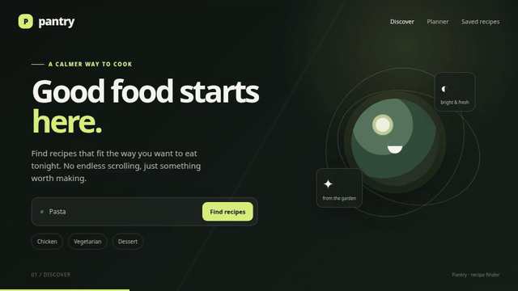

# Pantry

**Recipe** is the GitHub repository for Pantry, a calm, visual recipe finder built for people who want a useful meal idea without endless scrolling. Pantry searches TheMealDB, lets cooks refine results by category and cuisine, opens full recipe details, and keeps saved recipes in the browser.

## Product walkthrough



The animated walkthrough plays inline from the committed repository asset above. A direct MP4 player is also provided for clients that support HTML5 video:

<video controls muted loop playsinline preload="metadata" poster="https://raw.githubusercontent.com/vincenzo-afk/Recipe/main/assets/pantry-demo-poster.png" width="960">
  <source src="https://github.com/vincenzo-afk/Recipe/raw/refs/heads/main/assets/pantry-demo.mp4" type="video/mp4" />
  Your browser does not support the embedded video. [Open the Pantry walkthrough directly](https://github.com/vincenzo-afk/Recipe/raw/refs/heads/main/assets/pantry-demo.mp4).
</video>

The walkthrough is produced from the source-controlled [`docs/pantry-demo.html`](docs/pantry-demo.html) file. The committed GIF is the GitHub-compatible inline presentation, the MP4 is the portable video download, and the HTML source remains available for inspection and regeneration with [`scripts/render-demo.sh`](scripts/render-demo.sh).

## What Pantry does

Pantry turns recipe discovery into a focused flow: search by recipe, ingredient, or cuisine; narrow the results with filters; sort alphabetically; and open a detail view with the information needed to decide what to cook. Search state can be shared through the URL, and the interface includes loading, error, empty, image-fallback, keyboard, and reduced-motion states.

| Area | Included behavior |
| --- | --- |
| Discover | Free-text search, popular-search shortcuts, shareable query state, category and cuisine filters, and alphabetical sorting. |
| Recipe details | Recipe image, metadata, tags, ingredients, measurements, instructions, video link, and source link. |
| Saved recipes | Favorites can be saved from cards or the detail dialog and persist across reloads through browser local storage. |
| Weekly planning | Monday–Sunday navigation, breakfast/lunch/dinner slots, replacement, removal, drag-and-drop moves, and local persistence. |
| Shopping | The planner aggregates ingredients into a checkable list and subtracts ingredients marked as already available in the pantry inventory. |
| Estimates | Daily calories, protein, carbohydrates, and fat are shown as estimates based on ingredient-name matching; the budget estimator totals missing ingredients using editable local prices. |
| Nearby prices | With explicit browser location permission, Pantry can compare community-reported Open Prices observations and use OpenStreetMap Overpass as a discovery fallback. |

## Local development

[](https://picorunner.com/launch/?repository=https%3A%2F%2Fgithub.com%2Fvincenzo-afk%2FRecipe)

The project is a Vite-powered React and TypeScript application. It does not require an account, application-specific secret, server database, or backend service for local development.

```bash
pnpm install
pnpm dev
```

Open the local URL printed by Vite. Meal plans, checked shopping items, pantry inventory, budget edits, and favorites are stored locally in the browser. Recipe data comes from TheMealDB’s free developer test API; public distribution should follow TheMealDB’s supporter and attribution requirements.[1]

## Quality and production commands

| Command | Purpose |
| --- | --- |
| `pnpm dev` | Start the Vite development server. |
| `pnpm check` | Run the TypeScript compiler without emitting files. |
| `pnpm test` | Run the Vitest suite once. |
| `pnpm test:watch` | Run Vitest in watch mode. |
| `pnpm build` | Type-check and create the production build. |
| `pnpm preview` | Preview the production build locally. |
| `./scripts/render-demo.sh` | Render the HTML walkthrough into `assets/pantry-demo.mp4` and `assets/pantry-demo-poster.png`. |

## Data and privacy notes

The browser calls TheMealDB V1 JSON endpoints directly for meal-name search, category and area filters, option lists, and full meal lookup by ID. The app normalizes those responses before they reach the UI and ignores empty ingredient slots. TheMealDB does not provide nutrition fields in the recipe payload used here, so nutrition values are estimates rather than dietary, medical, or label-accurate calculations.[1]

Budget values are editable estimates and do not represent a retailer feed; they do not account for brand, package size, tax, store, or currency differences. Public price observations can be incomplete, stale, or unavailable for a particular ingredient or area. Browser geolocation is requested only after an explicit user action, and Pantry does not persist the coordinates.

## Repository structure

| Path | Purpose |
| --- | --- |
| `src/` | React components, hooks, API normalization, domain logic, and tests. |
| `index.html` | Vite application entry point and Pantry metadata. |
| `docs/pantry-demo.html` | Self-contained, animated HTML product walkthrough. |
| `assets/` | README-ready MP4 and poster generated from the walkthrough. |
| `scripts/render-demo.sh` | Reproducible Chromium and FFmpeg renderer for the walkthrough assets. |
| `LICENSE` | MIT license. |

## Security

Do not place GitHub credentials, API keys, or other secrets in source files, URLs, commit messages, or the README. Repository credentials should be handled outside Git metadata and revoked or rotated by the owner after use.

## References

[1]: https://www.themealdb.com/docs_api_guide.php "TheMealDB API Guide"
[2]: https://docs.github.com/en/get-started/writing-on-github/getting-started-with-writing-and-formatting-on-github "GitHub basic writing and formatting syntax"
